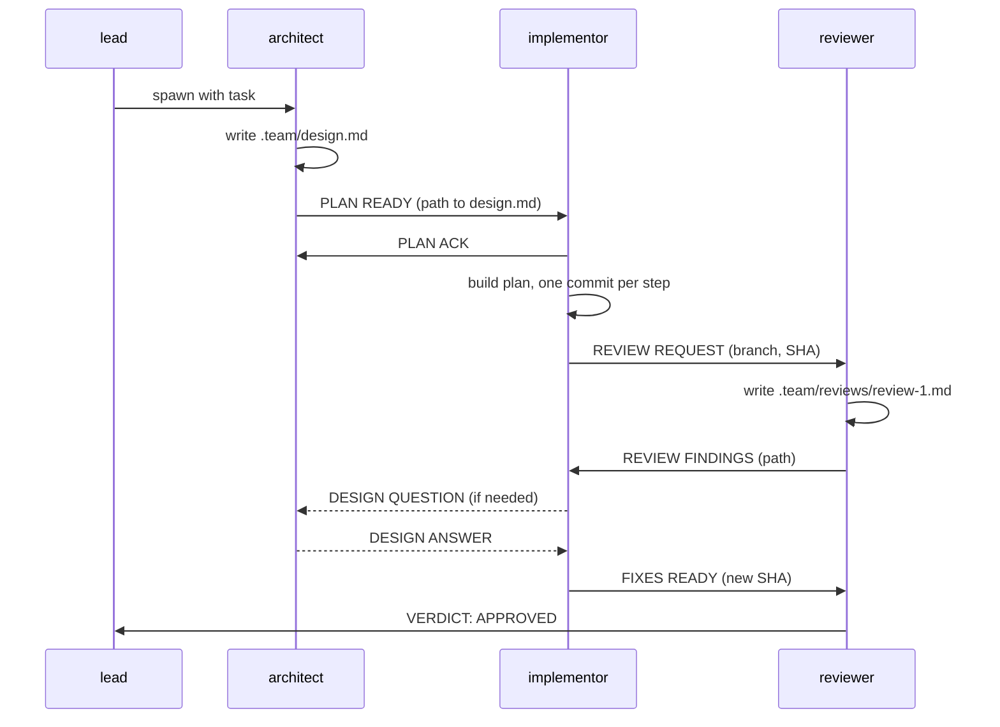

# A Dev Team of Agents: Messages for Signals, Documents for State

Getting several agents to work on one task is easy. Getting them to
cooperate without stepping on each other, losing context, or looping
forever is the real work. This repo is a deliberately small example: three
Claude Code agents — an **architect**, an **implementor**, and a
**reviewer** — that design, build, and review a change together.

The whole implementation is about 300 lines of Markdown, and nearly all of
it is coordination rules. That is the point. Once each agent can do its
own job, the rest is how they talk.

Two mechanisms carry everything:

1. **Messages** tell a teammate that something happened and what to do next.
2. **Shared documents** hold the substance everyone needs to agree on.

The rest of this post is the practices that make those two work.

## The team

| Agent | Job | Owns |
| --- | --- | --- |
| `architect` | Turns the task into a design and plan using [PDD](skills/pdd/SKILL.md) | `.team/design.md` |
| `implementor` | Builds the plan with TDD, then fixes review findings | The git branch |
| `reviewer` | Reviews the branch against the design; never edits code | `.team/reviews/review-N.md` |
| `lead` | You, or your session. Spawns the team and handles escalations | — |



Run it with:

```bash
cp agents/*.md ~/.claude/agents/
# enable agent teams in ~/.claude/settings.json:
#   "env": { "CLAUDE_CODE_EXPERIMENTAL_AGENT_TEAMS": "1" }

/dev-team Add a --json flag to the export command
```

## Practice 1: Messages are signals, documents are state

The most common failure in multi-agent systems is stuffing everything into
messages. The architect pastes a 2,000-word design into a message. The
implementor pastes a diff. The reviewer pastes a list of findings. Now the
same facts live in three places, each slightly different, and nobody can
tell which is current.

Instead, split the two jobs:

- A **message** is short and typed. It says *what happened* and *where to
  look*: `PLAN READY — design is at .team/design.md, 6 steps.`
- A **document** is durable and complete. It is the thing you would hand a
  new teammate who joined mid-task.

If a late-joining agent could read only the documents and still understand
the situation, you have split state from signal correctly.

The `.team/` directory is that shared state:

```
.team/
├── design.md          # architect writes; everyone reads
└── reviews/
    ├── review-1.md    # reviewer writes; implementor reads
    └── review-2.md
```

## Practice 2: The design document is the contract

The architect runs [PDD (Prompt-Driven Development)](skills/pdd/SKILL.md),
which walks a rough idea through requirements, research, design, and an
ordered plan, all written into a single file, `design.md`:

```markdown
# <Title>
## Requirements
## Research
## Design
### Decisions
- <decision>: <choice> because <reason>. Rejected: <alternative>.
## Plan
- [ ] Step 1: ...
```

This document does three jobs at once:

- **It is the handoff.** The implementor never asks "what did you mean?";
  they read the file.
- **It is the review standard.** The reviewer checks the branch against the
  design, not against their own taste. "Trust the design" is an explicit
  principle in the reviewer's instructions, so review does not become a
  second design debate.
- **It is the paper trail.** Every non-obvious choice records the reason
  and the rejected alternative.

The rule that keeps it trustworthy: **if it is not in `design.md`, it was
not decided.**

## Practice 3: One writer per document

Shared documents break the moment two agents edit the same file. So every
artifact has exactly one owner:

- Only the architect writes `design.md`.
- Only the reviewer writes `review-N.md`.
- Only the implementor writes code.

Everyone else reads. When the implementor needs the design to change, they
do not edit it; they send a `DESIGN QUESTION`, and the architect updates
the file and replies with a `DESIGN ANSWER` naming the section that
changed. The edit history of each file is then a single author's story.

Single ownership also removes the need for worktrees, locks, or merge
logic. Only the implementor touches the working tree, and the other agents
are read-only on it.

## Practice 4: Typed messages with fixed headers

Every message starts with a header from a closed vocabulary:

| Header | From → To | Meaning |
| --- | --- | --- |
| `PLAN READY` | architect → implementor | Design is done; read `design.md` |
| `PLAN ACK` | implementor → architect | I read it all |
| `DESIGN QUESTION` / `DESIGN ANSWER` | implementor ↔ architect | Plan gap, and its resolution |
| `REVIEW REQUEST` | implementor → reviewer | Branch and SHA are ready |
| `REVIEW FINDINGS` | reviewer → implementor | See `review-N.md` |
| `FIXES READY` | implementor → reviewer | New SHA; per-finding status |
| `VERDICT: APPROVED` / `ESCALATE` | reviewer → lead | Terminal outcomes |

Headers make an agent's behavior a lookup instead of an inference: on
`REVIEW FINDINGS`, run the "address findings" procedure. They also make
the transcript greppable and the protocol easy to review as a table, which
is how each agent file presents it.

Each agent's file lists the messages it **sends** and **receives**. If a
message is not in both places, it is a bug in the protocol.

## Practice 5: Design the topology, don't leave it open

Not every agent should be able to talk to every other agent. Here the
reviewer is told: *do not message the architect*. A design concern in a
review goes to the implementor, who has the context for what triggered it
and who decides whether it is worth a `DESIGN QUESTION`.

This keeps the architect from being pulled into line-level debates and
keeps each question attached to the person who can best frame it. Write the
communication graph down, and forbid the edges you do not want.

The lead is a special node: agents message it only when they are blocked or
done. Everything else flows teammate to teammate, so the lead is not a
bottleneck.

## Practice 6: Handshakes before handoffs

Agents are asynchronous and can go idle at any moment. A fire-and-forget
`PLAN READY` leaves the architect unsure whether the implementor ever read
it. So handoffs are acknowledged: the implementor sends `PLAN ACK` once
they have read the full design, and the architect asks once if it does not
arrive.

An ack is cheap, and it moves the discovery of a dropped handoff from
"much later, confusingly" to "right now, obviously."

## Practice 7: Bound every loop, and escalate

Implementor and reviewer form a loop: findings, fixes, re-review. Loops
between agents need a stop condition, or they run until your budget does.

Here the lead sets **N**, the maximum review cycles (default 3). The
reviewer keeps a pass counter. If pass N still has blocking issues, the
reviewer does not start another round; it sends `VERDICT: ESCALATE` to the
lead with the unresolved issues. The human then picks `EXTEND`, `ACCEPT`,
or `ABANDON`.

Two further guards keep the loop honest:

- **Classify findings.** Only *blocking* findings force another round.
  Non-blocking ones are suggestions. Without this split, the loop never
  converges.
- **One round, not drip-feed.** The reviewer reports every blocking issue
  in a single pass, because each late-discovered issue costs a full cycle.

## Practice 8: Silence is not completion

An agent going idle does not mean it is done; it might be stuck, waiting,
or confused. So completion is always an **explicit terminal message**:

- The reviewer must send `VERDICT: APPROVED` or `VERDICT: ESCALATE` before
  it stops. Its instructions say it may never go idle without a verdict or
  an explicit wait.
- The lead acts only on explicit messages. If the reviewer goes idle with
  no verdict, the lead asks once, then reports the state to you rather than
  guessing.

Define what "done" looks like as a message, and make it the only thing
that counts.

## Practice 9: Give each agent one job and a short prompt

Each agent file is under 100 lines and has the same sections: who you are,
the message table, the documents you own, the process, and a few
principles. Narrow roles are easier to prompt and easier to debug: when a
review is bad, you read `reviewer.md`, not a monolith.

Match model to role, too. The architect makes the decisions everyone
depends on, so it runs on a stronger model. The implementor and reviewer
follow well-specified procedures, so a faster one is enough.

## What was left out

The full version of this system has a security reviewer, a second
architectural reviewer, GitHub PR integration, CI gating, Jira and
Confluence research, per-agent git worktrees, and separate skills for task
generation and code assistance. Each is useful in production. None of them
changes the coordination ideas above, and each makes them harder to see.
If you add agents, apply the same practices: one owner per document, a
typed message per handoff, an explicit terminal state.

## Layout

```
.claude-plugin/plugin.json
agents/
├── architect.md
├── implementor.md
└── reviewer.md
skills/
├── dev-team/SKILL.md    # the lead: spawns the team, handles escalations
└── pdd/SKILL.md         # the design document process
```
