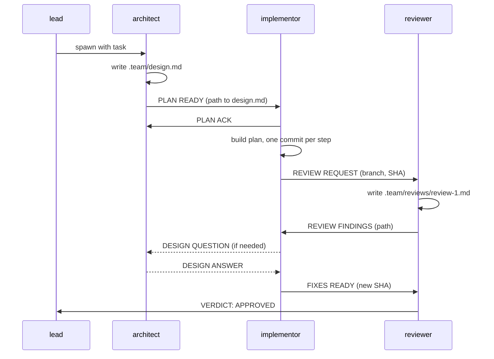

# dev-team

This repo contains **agents** and **skills** that together create a
virtual team of agents that design, implement, and review a task
end-to-end.

## Setup

Install the agents and skills into your Claude Code config:

```bash
cp agents/*.md ~/.claude/agents/

npx skills add -g https://github.com/Workiva/dev-team
```

Enable agent teams in `~/.claude/settings.json`

```json
"env": {
    "CLAUDE_CODE_EXPERIMENTAL_AGENT_TEAMS": "1"
}
```

## How it works

Invoke the `/dev-team` skill with a task description (optionally
including a JIRA ticket number):

```
/dev-team Implement returnedCount on ProjectTaskSummary (INFENG-1234)
```

## The team

| Agent         | Job                                                                    | Owns                        |
| ---           | ---                                                                    | ---                         |
| `architect`   | Turns the task into a design and plan using [PDD](skills/pdd/SKILL.md) | `.team/design.md`           |
| `implementor` | Builds the plan with TDD, then fixes review findings                   | The git branch              |
| `reviewer`    | Reviews the branch against the design; never edits code                | `.team/reviews/review-N.md` |
| `lead`        | You, or your session. Spawns the team and handles escalations          | —                           |



